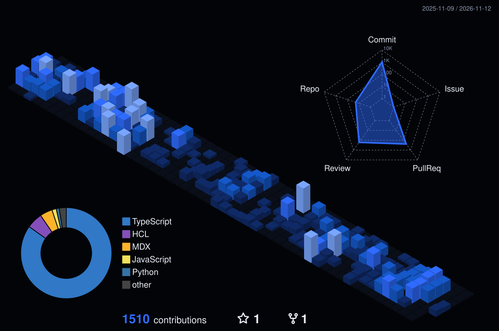

  

  <a href="mailto:leonardolopesdeveloper@gmail.com">Email</a> ·
  <a href="https://www.linkedin.com/in/leonardowilliamlopes/">LinkedIn</a> ·
  <a href="https://www.leonardolopes.tech/contact">Contact</a> ·
  <a href="https://www.leonardolopes.tech">leonardolopes.tech</a>

